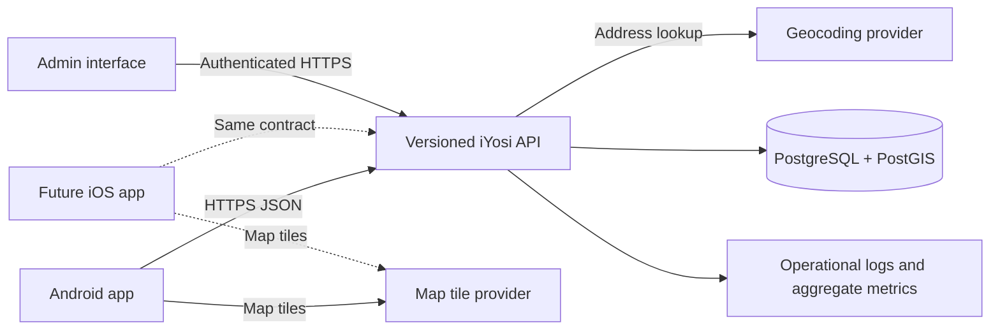

# Conceptual architecture

**Handoff lane:** Work → Codex review  
**Status:** API and Android pilot client implemented; admin UI remains to be built. Android build and device testing still require an Android SDK host.

## System shape

iYosi starts as a small modular monolith: one versioned API, one spatial database, an Android client, and a minimal admin interface. The API is the only writer of place and moderation data. An iOS client can later use the same contract. The architecture keeps map display and address lookup behind replaceable provider boundaries, since their terms and costs are not yet selected.

The admin interface can be a simple internal web client; it does not need a separate backend. No message broker, search cluster, or microservice is justified for the first NCR pilot. A database-backed moderation queue is sufficient until measured load says otherwise.

## Responsibilities and trust boundaries

| Component | Owns | Does not own |
| --- | --- | --- |
| Android client | Map interaction, filters, address entry, optional foreground GPS, contribution forms, age prompt | Legal-status decisions, contributor identity supplied to writes, moderation rules |
| API | Validation, authorization, place lifecycle, duplicate checks, ratings, confirmations, reporting, provider proxy, public responses | Raw map tiles or continuous user movement |
| Spatial database | Published places, pending submissions, contributions, audit history, NCR boundary, spatial indexes | Application policy decisions by itself |
| Admin interface | Reviewing evidence and reports, correcting/merging/hiding records | Bypassing API authorization or audit logging |
| External providers | Map tiles and address suggestions | iYosi place status or moderation decisions |

The public mobile app is untrusted input. The API derives account identity from authentication, never from a request field. Database access remains private to API and admin operations. Contributor identities, report details, and moderation history are not included in public place responses.

## Main data flows

1. **Browse:** The app requests a bounded map viewport. The API queries published records with a spatial index and returns compact pins; place details load on tap. Map tiles come directly from the chosen tile provider.
2. **Search and locate:** Typed address searches go through an API adapter to the selected geocoder. GPS is requested only after a “near me” action. Neither path creates a server-side movement history.
3. **Suggest a place:** A signed-in adult submits a place proposal with a precise area pin, optional public-entrance pin, and access notes. The API checks NCR bounds and nearby duplicates, then records a pending submission. An admin publishes it as a place or rejects/merges it. A user cannot choose `verified_designated` in the request.
4. **Confirm and review:** A confirmation records a time-bound observation (`still_there`, `changed`, `gone`). A review records one account’s stars and optional comments. Neither changes the verified label automatically. Changes and “gone” observations raise moderation work.
5. **Report and moderate:** A report targets a place or review. Admin decisions update publication or advisory status through the API and append an audit event. Removed or disputed content remains auditable internally.

## Place lifecycle

There are three independent dimensions:

- **Kind:** `public_designated`, `venue_designated`, `informal_outdoor`, or `venue_claim` describes what is being reported.
- **Advisory status:** `verified_designated`, `community_reported`, `disputed`, `prohibited`, or `closed` describes the current assessment. Only an admin may set `verified_designated`, with evidence and review time.
- **Publication state:** `pending`, `published`, `hidden`, `rejected`, or `merged` controls whether the record appears publicly. A pending submission is not yet a public place.

This avoids treating popularity as permission. A known prohibited spot can be represented as a warning, but should not receive a recommendation or directions treatment. A closed or hidden place is excluded from ordinary map results; a previously shared link can return a clear unavailable state without exposing private moderation details.

## Deployment path

The repository already has a Python workspace container and a PostgreSQL/PostGIS database container in [Compose](../compose.yaml). The next step adds the API application and migrations to that environment. For a private pilot, the same API image can run on a hosted server or a repurposed PC. Public deployment additionally requires TLS, secrets management, backups stored off-machine, health monitoring, database migration procedure, and incident recovery. No production host is selected yet.

## Review decisions for Codex

1. Confirm the modular-monolith boundary and whether the first admin interface is server-rendered or a small separate web client.
2. Choose an authentication provider and define an adult-access mechanism; client-only age attestation is a prototype measure, not verified age assurance.
3. Select map tile/geocoding providers and confirm licensing, rate limits, and Android/iOS support.
4. Select an authoritative NCR polygon source and decide how close-to-boundary submissions are handled.
5. Define acceptable evidence for a designated area, evidence retention, and who may perform admin review.
6. Confirm whether public `prohibited` warning pins are shown by default or only through a filter.

## Codex review outcome (2026-09-25)

The modular monolith and PostGIS boundary stand. The first admin interface can be a small web client of the same API; no separate backend is needed. The repository currently supplies admin endpoints, not a web UI. Contributor accounts use email/password, a 24-hour bearer token, and a server-recorded adult self-attestation. Anonymous reads work. This is a private-pilot access mechanism; public age assurance and account recovery require a product/operational decision.

The API includes a geocoder adapter that accepts a configured GeoJSON feature-search endpoint. No vendor is baked into the contract; without `GEOCODER_URL`, address suggestions return `503`. Tile choice belongs to the mobile client. The NCR polygon is a committed, simplified [geoBoundaries gbOpen PHL ADM1 feature](https://www.geoboundaries.org/api.html), derived from NAMRIA/PSA/OCHA sources under CC BY 3.0 IGO. Boundary points are included; points outside are rejected. Near-edge disagreements should be reviewed manually before changing this seed. A more precise official boundary can be loaded with `scripts/load_boundary.py` after operational review.

Verification accepts current signage, venue confirmation, or an official listing, with a public source summary, private evidence note, and admin review time. Only an admin can make the status change; source collection and retention require the launch privacy review. `prohibited` is opt-in for map collections and has no public access point or directions note. `closed` is excluded from collections but returns a status on direct links. Both choices are API defaults and may be revised from pilot feedback.
